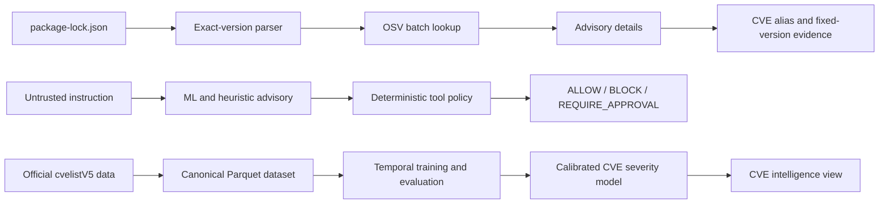

# VulnScope

VulnScope is a technical prototype for evidence-aware vulnerability triage and
AI-agent security. It combines exact dependency-version analysis, published
advisory evidence, deterministic tool authorization, prompt-injection detection,
and a temporally evaluated CVE intelligence model.

**Live demo:** [vulnscope.streamlit.app](https://vulnscope.streamlit.app/)

The central design principle is simple: keep facts, predictions, policies, and
unknowns separate. An installed-version match is evidence of an affected
component; it is not proof that vulnerable code is reachable or exploitable in a
particular application.

## What the prototype demonstrates

### Supply-chain evidence

Upload an npm `package-lock.json` or `npm-shrinkwrap.json` to:

- extract exact installed versions without installing or executing packages;
- distinguish direct, transitive, development, and runtime dependencies;
- query [OSV](https://osv.dev/) for matching published advisories;
- connect an OSV/GHSA advisory to its CVE alias;
- display the advisory name, affected package, installed version, published
  severity, dependency path, and known fixed versions; and
- preserve the boundary: **Application impact not assessed.**

```text
package-lock.json
        -> exact package and version
        -> OSV advisory match
        -> CVE alias and advisory evidence
        -> investigation required for application impact
```

### Prompt and tool guardrails

The agent-security view deliberately separates two layers:

1. A calibrated TF-IDF + linear-SVM model and transparent heuristics provide an
   advisory prompt-injection signal.
2. Deterministic policy returns `ALLOW`, `BLOCK`, or `REQUIRE_APPROVAL` for the
   requested tool and resource scope.

The classifier cannot grant permissions, and this prototype does not execute the
proposed tool. On a held-out external synthetic test set of 545 prompts, the
classifier reached 95.0% recall and 52.7% precision. That trade-off is why its
output remains advisory rather than authoritative.

### CVE intelligence

The supporting CVE engine analyzes more than 379,000 CVE records and answers one
narrow question:

> From a CVE's title and description, does it resemble CVEs that ultimately
> received a CVSS base score of 7.0 or higher?

It predicts a **High/Critical CVSS profile**, not exploitation, reachability,
breach likelihood, or organization-specific risk.

| Metric | Untouched 2025 temporal test |
|---|---:|
| CVEs evaluated | 45,198 |
| Precision | 63.3% |
| Recall | 80.5% |
| F1 | 0.708 |
| PR-AUC | 0.764 |
| Brier score | 0.178 |

The model uses CVEs published from 2020–2023 for fitting, January–June 2024 for
probability calibration, July–December 2024 for threshold selection, and 2025
only for final temporal evaluation.

## Application views

The Streamlit application has five views:

1. **Overview** — the separation between detection, authorization, component
   inspection, and vulnerability investigation.
2. **Prompt & tool guardrails** — advisory ML and heuristic signals followed by
   deterministic authorization.
3. **Supply-chain scan** — individual OSV lookup and full npm lockfile scanning.
4. **CVE intelligence** — CVE search and interpretable severity-model output.
5. **Evidence & roadmap** — measured results, implementation boundaries, and
   planned work.

## Architecture



## Run locally

Python 3.11 or 3.12 is recommended.

```bash
git clone https://github.com/mishrasharanya/VulnScope.git
cd VulnScope
python3.12 -m venv .venv
source .venv/bin/activate
python -m pip install -r requirements.txt
python -m streamlit run app.py
```

The core application does not require an API key. OSV lookups require an
internet connection.

## Tests

```bash
pytest -q
```

The test suite covers lockfile parsing, OSV response normalization, dependency
mapping, prompt and tool-policy behavior, CVE service behavior, and incremental
pipeline safety.

## Project structure

```text
VulnScope/
|-- app.py                              # Main Streamlit entry point
|-- app_v2.py                           # Complete interactive prototype
|-- artifacts/
|   |-- cve_priority_model.joblib
|   `-- prompt_injection_model.joblib
|-- data/
|   |-- processed/cves_clean.parquet
|   `-- predictions/
|-- notebooks/
|   `-- 01_vulnscope_end_to_end_analysis.ipynb
|-- reports/                            # Evaluation and ingestion evidence
|-- src/
|   |-- agent_security.py               # Detection and tool policy
|   |-- npm_lockfile_scanner.py         # Exact npm dependency extraction
|   |-- osv_service.py                  # OSV client and normalization
|   |-- train_cve_priority_model.py
|   |-- train_prompt_injection_model.py
|   `-- vulnscope_service.py
`-- tests/
```

## Evaluation approach

VulnScope includes a repeatable ML evaluation harness rather than reporting a
single training score. It uses disjoint fitting, calibration, threshold-selection,
and test partitions; records model metadata; measures precision, recall, F1,
PR-AUC, calibration, false positives, and false negatives; and exports artifacts
for error, leakage, and subgroup analysis.

Only CVE title and description are predictors for the CVE model. CVSS fields are
used to construct historical labels and are excluded from the feature set.
Exploitation-related fields are quarantined to avoid leaking later evidence into
the model.

## Current boundary and roadmap

The prototype establishes that an exact installed version matches a published
advisory and makes the available evidence inspectable. It does not yet determine
whether an affected function is used, externally reachable, or mitigated by the
application environment.

Planned extensions include:

- CISA Known Exploited Vulnerabilities enrichment;
- current and point-in-time EPSS enrichment;
- repository-level evidence collection with cited files and lines;
- explicit `REMEDIATE`, `DISMISS`, or `INCONCLUSIVE` triage outcomes;
- dependency-chain tracing beyond the installed path;
- sandboxed tool execution, identity-aware approval, and immutable audit logs;
- evaluation sets focused on evidence correctness and false dismissals.

KEV membership would provide evidence of known exploitation; absence from KEV
would not prove non-exploitation. EPSS would provide a population-level estimate
of exploitation probability, not application-specific reachability. These signals
must remain distinct from the final contextual triage decision.

## Responsible interpretation

- An OSV match means the exact installed version is associated with a published
  affected range. It does not prove application exploitability.
- A model flag means the CVE text resembles historically High/Critical CVEs at
  the selected threshold. It is not an exploitation forecast.
- A prompt-injection classification is an advisory signal, not authorization.
- Fixed versions are candidate remediation evidence; upgrades still require
  compatibility testing and deployment verification.
- Operational decisions should combine vendor guidance, threat evidence,
  application reachability, asset criticality, compensating controls, and human
  review.

VulnScope is an independent research and engineering prototype. It is not a
production enforcement gateway and is not affiliated with or endorsed by any
third-party security company.
